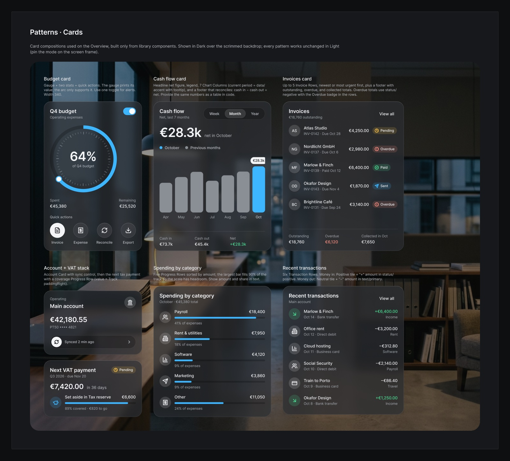

# Clearbook

A glass design system for accounting dashboards: translucent graphite or frosted white panels over a photographed
studio, one blue accent for the current figure and the main action, and Inter with tabular figures so numbers line up.
It was designed in Figma first, in the file **Clearbook — Accounting Design System**, and every value here is exported
from that file.

**Working app built with it:** [Clearbook](https://github.com/guiboorges/clearbook) ([live demo](https://guiboorges.github.io/clearbook/)).


| Dark | Light |
|---|---|
|  |  |

## Contents

| Path | What it is |
|---|---|
| `tokens/color.tokens.json` | 29 primitives (neutral, blue, green, red, amber) and 30 semantic roles in `dark` and `light`. Glass roles are 8-digit hex (`#RRGGBBAA`); the rest alias primitives. |
| `tokens/typography.tokens.json` | The 14 text styles (Display Hero and KPI, Headings 1–3, Body, Body Medium and Strong, Label, Label Small, Caption, Overline, Numeric and Numeric Small) |
| `tokens/layout.tokens.json` | Spacing (4 px base), radii (xs 6 → 2xl 32, full), shadows (shell, card, control, floating), and the CSS blur for each glass level |
| `css/clearbook.tokens.css` | **Generated** CSS variables (`--clearbook-*`). Run `python3 build/build-css.py` after editing tokens. |
| `assets/icons/` | The 43 Lucide icons used in the Figma library (ISC license) |
| `assets/images/` | The two studio backdrops (dusk for dark, morning for light), generated with Figma AI |
| `preview/` | Figma exports of the cover, both Overview screens, and the card patterns, plus the running app |

## Use it

```html
<link rel="stylesheet" href="https://fonts.googleapis.com/css2?family=Inter:wght@400;500;600&display=swap">
<link rel="stylesheet" href="clearbook/css/clearbook.tokens.css">
```

- **Theme:** dark by default, light when the OS prefers it. Force one with `<html data-theme="light">` or `data-theme="dark"`. `class="clearbook-light"` or `class="clearbook-dark"` pins a subtree, like Figma's explicit modes.
- **The backdrop and the scrim go together.** Put a photo behind the window and `--clearbook-bg-scrim` over it. Every contrast figure below assumes both.
- **Glass levels:** the window uses `--clearbook-surface-shell` with `backdrop-filter: blur(var(--clearbook-blur-shell))`, cards use `surface-card` with `blur-card`, and small controls use `surface-raised`. Figma's background blur is about twice the CSS value (40 → 20 px, 24 → 12 px).
- **Fallbacks are built in.** Under `prefers-reduced-transparency: reduce`, or in a browser without `backdrop-filter`, the glass roles switch to opaque values. Add `border-color: var(--clearbook-border-control)` to cards under `prefers-contrast: more`.
- **Numbers:** use `font-variant-numeric: tabular-nums` on KPI, display, and numeric styles.
- **Accent:** blue marks the primary action, the active state, and the current data point. Status colors (positive, negative, warning) always come with an icon and a sign or a label; badge labels stay `text-primary`.



## Accessibility

Contrast was measured on rendered pixels, both in Figma and in the browser, at the darkest and lightest point where
the photo shows through each card, because blur over a photo shifts the card color.

| Role on cards | Dark (worst) | Light (worst) |
|---|---|---|
| `text-primary` | 11.6:1 | 12.6:1 |
| `text-secondary` | 7.1:1 | 6.3:1 |
| `text-tertiary` | 5.7:1 | 4.84:1 |
| `accent-default` as text | 5.6:1 | 4.65:1 |
| `status-negative` | 5.7:1 | 5.07:1 |
| `data-neutral` bars (non-text, 3:1) | 3.9:1 | 3.24:1 |

| Item | Rule |
|---|---|
| `text-tertiary` on the light window glass (outside cards) | 3.9:1 there, so it is used only inside cards. Tabs and the search placeholder use `text-secondary`. |
| Tinted badge labels | Colored labels on the 16% tints measured 3.6–4.1:1 on dark glass, so labels stay `text-primary` and the icon carries the color. |
| `border-subtle`, `data-grid` | Decorative only. Control boundaries use `border-control` (≥ 3:1). |

## The working app

[Clearbook](https://github.com/guiboorges/clearbook) is the Overview screen built with these tokens, running on a
simulated design studio ([live demo](https://guiboorges.github.io/clearbook/)).


