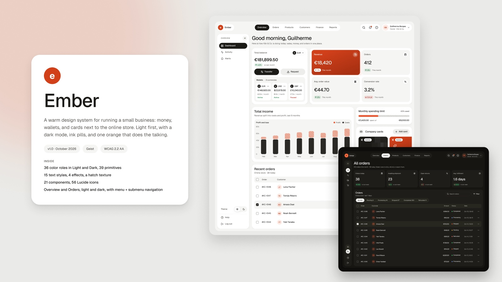
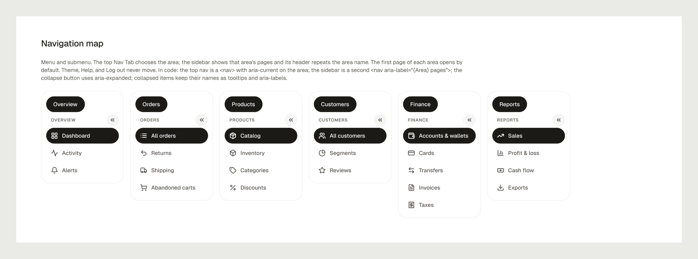

# Ember

A warm, light-first design system for running a small business: money, wallets, and company cards next to the online
store. Warm neutral surfaces, ink pills for the main action, one orange that does the talking, hatched profit bars, and
Geist with tabular figures. It was designed in Figma first, in the file **Ember — Business & Store Design System**, and
every value here is exported from that file.

**Working app built with it:** [Ember Commerce](https://github.com/guiboorges/ember-commerce) ([live demo](https://guiboorges.github.io/ember-commerce/)).



| Light | Dark |
|---|---|
|  |  |

## Contents

| Path | What it is |
|---|---|
| `tokens/color.tokens.json` | 39 primitives (warm neutral, orange, green, red, amber, blue) and 36 semantic roles in `light` and `dark`, aliasing the primitives |
| `tokens/typography.tokens.json` | The 15 text styles (Display Greeting, KPI, and Balance; Headings 1–3; Body, Body Medium, Body Strong; Label, Label Small; Caption; Overline; Numeric and Numeric Small) |
| `tokens/layout.tokens.json` | Spacing (4 px base), radii (xs 6 → 2xl 28, full), shadows (card, floating, hero), and sizes (sidebar 216 / 72, control 40, button 44) |
| `css/ember.tokens.css` | **Generated** CSS variables (`--ember-*`), plus `--ember-hero-gradient`. Run `python3 build/build-css.py` after editing tokens. |
| `assets/icons/` | The 56 Lucide icons used in the Figma library (ISC license) |
| `preview/` | Figma exports of the cover, both Overview screens, and the navigation map, plus the running app |

## Use it

```html
<link rel="stylesheet" href="https://fonts.googleapis.com/css2?family=Geist:wght@400;500;600;700&display=swap">
<link rel="stylesheet" href="ember/css/ember.tokens.css">
```

- **Theme:** light by default, dark when the OS prefers it. Force one with `<html data-theme="dark">` or `data-theme="light"`. `class="ember-light"` or `class="ember-dark"` pins a subtree, like Figma's explicit modes.
- **Two oranges:** `--ember-data-accent` (orange/500, #F0532A) is for charts, bars, and the limit fill only; it is 3.5:1 on white. Text and buttons use `--ember-accent-default` (orange/600, white text 4.68:1) or `--ember-accent-text` (orange/700).
- **Hero:** `--ember-hero-gradient` with `--ember-text-on-hero` and `--ember-shadow-hero`. Use it on one tile per view.
- **Hatch:** profit bars and the unused part of a limit use diagonal stripes, `repeating-linear-gradient(135deg, var(--ember-data-accent) 0 2.5px, transparent 2.5px 8px)` over `--ember-accent-subtle`.
- **Deltas:** direction and meaning are separate. An arrow shows the direction; the green or red tint shows whether that is good (expenses going up is red with an up arrow).
- **Numbers:** `font-variant-numeric: tabular-nums` on Display and Numeric styles.

## Navigation: menu and submenu

The top tabs choose an area; the sidebar lists that area's pages, with the area name at the top. The sidebar collapses
from 216 px with labels to 72 px with icons; theme, help, and account actions never move.



## Accessibility

Surfaces are opaque, so the WCAG 2 ratios are exact (computed for every role on the surfaces it sits on):

| Role | Light (worst) | Dark (worst) |
|---|---|---|
| `text-primary` | 14.4:1 | 12.5:1 |
| `text-secondary` | 6.2:1 | 7.2:1 |
| `text-tertiary` | 4.55:1 | 4.9:1 |
| White on `accent-default` / ink on dark accent | 4.68:1 | 6.1:1 |
| Delta text on its tint | ≥ 5.2:1 | ≥ 4.7:1 |
| `data-accent` bars (non-text, 3:1) | 3.2:1 | 5.3:1 |

Order statuses pair a dot with a label, deltas pair an arrow with a value, and selected nav items change shape (an ink
pill), not only color. `border-control` (≥ 3:1) marks inputs and checkboxes; `border-subtle` is decorative.

## The working app

[Ember Commerce](https://github.com/guiboorges/ember-commerce) runs the six areas and 23 pages on a simulated shop,
Kiln & Co. ([live demo](https://guiboorges.github.io/ember-commerce/)).


