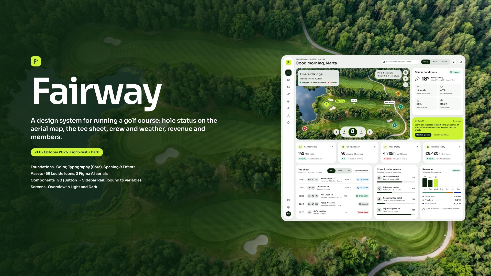
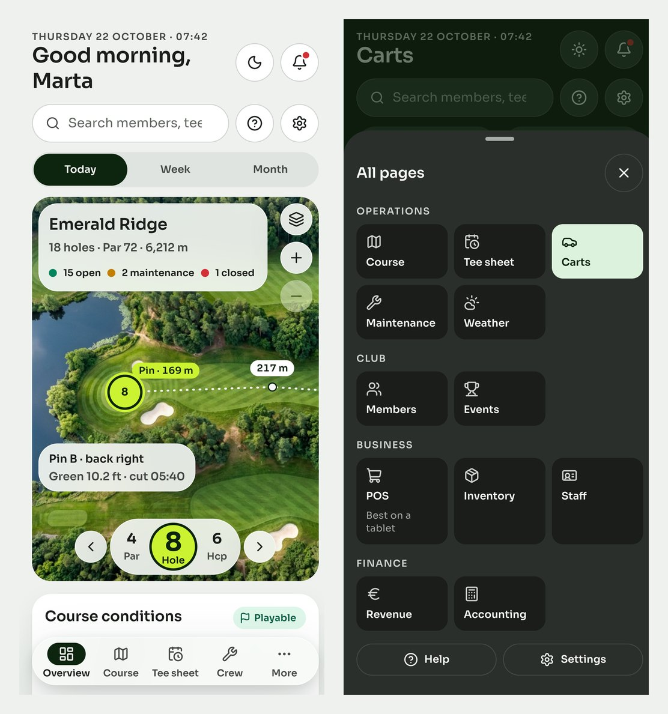

# Fairway

A light-first design system for running a golf course and its business: hole status on an aerial map of the course,
the tee sheet, carts, crew and agronomy, members and events, the pro shop till, stock, staff, and the books. Frosted
glass floats over the course photo, data sits on solid cards, forest ink carries text and actions, and one electric
lime marks what matters most. The type is Sora, with tabular figures. It was designed in Figma first, in the file
**Fairway — Golf Course Management Design System**, and every value here is exported from that file.



| Light | Dark |
|---|---|
|  |  |

## Contents

| Path | What it is |
|---|---|
| `tokens/color.tokens.json` | 62 primitives (neutral, forest, lime, success, warning, danger, info, sand, and 6 chart hues in light and dark) and 53 semantic roles in `light` and `dark`, aliasing the primitives |
| `tokens/typography.tokens.json` | The 17 text styles (Display, KPI Large and Medium, Headings 1–3, Body Regular and Strong, Label and Label Small, Caption, Overline, Numeric Default, Strong and Small, Map Tag, Hole Number) |
| `tokens/layout.tokens.json` | Spacing (4 px base, `space-0` to `space-11`), radii (xs 6 → 2xl 32, full), sizes (controls 32/40/48, rail 80, icons 16/20), shadows (card, floating, pop), and glass blur (24, 40) |
| `css/fairway.tokens.css` | **Generated** CSS variables (`--fw-*`). Run `python3 build/build-css.py` after editing tokens. |
| `assets/icons/` | The 59 Lucide icons used in the Figma library (lucide-static 1.61.0, ISC license) |
| `assets/images/` | The two aerial photos generated with Figma AI for the fictional Emerald Ridge Golf Club |
| `preview/` | Figma exports of the cover and both Overview screens, plus the running app on desktop and phone |

## Use it

```html
<link rel="stylesheet" href="https://fonts.googleapis.com/css2?family=Sora:wght@400;600;700&display=swap">
<link rel="stylesheet" href="fairway/css/fairway.tokens.css">
```

- **Theme:** light by default, dark when the OS prefers it. Force one with `<html data-theme="dark">` or
  `data-theme="light"`. `class="fw-light"` or `class="fw-dark"` pins a subtree, like Figma's explicit modes.
- **Lime is a fill, never text on light.** `--fw-accent-default` (#CCF331) always carries `--fw-text-on-accent`
  (forest ink, 12.9:1). Use it once per view: the Insight card, the selected hole, today's bar. The Insight card
  pins `fw-light`, so it reads the same in dark mode.
- **Glass:** `--fw-surface-glass` is for icon-only controls over the photo; any glass panel that carries text uses
  `--fw-surface-glass-strong` with `backdrop-filter: blur(var(--fw-blur-24))` and a 1 px `--fw-border-glass`. Both
  become opaque under `prefers-reduced-transparency` or `prefers-contrast: more`, and should fall back to opaque in
  `@supports not (backdrop-filter: blur(1px))`.
- **Photo:** text straight on the photo needs `--fw-surface-scrim` (forest at 60%). Distances on the map always sit
  in a solid Map Tag pill.
- **Weights:** 400, 600, 700 only. Figma has no Sora Medium, so the system skips 500 in both places.
- **Numbers:** `font-variant-numeric: tabular-nums` on KPI, Numeric, and Map Tag styles.
- **Status:** an icon, a color, and a label, always together. Open = check, Closed = ban, Maintenance = wrench,
  On course = dot, Booked = clock.
- **Deltas:** direction and meaning are separate. Pace of play going up is bad: red tint with an up arrow.
- **Charts:** `--fw-data-1` … `--fw-data-6` with direct labels. Today's bar is lime with a 1.5 px ink outline.

## Components in Figma

Button, Icon Button, Nav Item, Tab, Tab Item, Segmented, Status Chip, Delta Badge, Map Tag, Hole Marker, Hole Dial,
Progress Bar, Avatar, KPI Card, Weather Metric, Search Field, Legend Item, Select, Checkbox, Fact, Table Row, Data Row,
Hole Row, Hour Tile, Tee Time Row, Task Row, Cart Tile, Product Tile, Order Line, Popover Item, Tab Bar, Logo, and
Sidebar Rail. All are bound to the variables, and icons are instance-swap properties. Progress values are the
track's right padding: `(1 − value) × width`.

## Navigation: a grouped rail and a phone tab bar

Each menu item is its own page. On a computer the rail groups the 13 pages under Home, Operations (Course, Tee sheet,
Carts, Maintenance, Weather), Club (Members, Events), Business (Point of sale, Inventory, Staff), and Finance (Revenue,
Accounting), with a hairline between groups and a tooltip on every icon. Pages with sections get a row of tabs under
the title. On a phone a glass Tab Bar holds Overview, Course, Tee sheet, and Crew; **More** opens a sheet with every
page in the same groups. The point of sale is designed for tablets and computers, and the sheet says so.

## The working app

Fairway Course runs all 13 pages on a simulated club, Emerald Ridge Golf Club: groups tee off and finish, carts
drain and charge, crew jobs close and reopen holes, and the till takes stock off the shelf. Its repository is
private for now.




## Accessibility

Card surfaces are opaque, so these WCAG 2 ratios are exact. They are the worst case across `bg-canvas`,
`surface-default`, and `surface-raised`, computed from the tokens in this folder:

| Role | Light (worst) | Dark (worst) |
|---|---|---|
| `text-primary` | 14.95:1 | 12.81:1 |
| `text-secondary` | 8.05:1 | 8.89:1 |
| `text-tertiary` | 5.23:1 | 5.89:1 |
| `accent-text` | 5.56:1 | 10.63:1 |
| Ink on lime (`text-on-accent`) | 12.88:1 | 12.88:1 |
| `action-on-primary` on `action-primary` | 15.52:1 | 13.97:1 |
| `status-*-fg` on its subtle tint and on surfaces | ≥ 6.24:1 | ≥ 6.24:1 |
| `border-strong` (non-text, 3:1) | 3.45:1 | 5.89:1 |
| `focus-ring` (non-text, 3:1) | 14.46:1 | 10.63:1 |
| `data-1` … `data-6` (non-text, 3:1) | ≥ 3.41:1 | ≥ 3.46:1 |

Hole markers on the map: white numbers on open (4.70:1) and closed (4.93:1), ink on maintenance (4.96:1) and on the
lime selected marker (12.88:1).

Glass varies with the photo underneath, so it was measured on the rendered Figma Overview, sampling the panel padding
over the darkest forest: `text-secondary` on `surface-glass-strong` is 7.17:1 in light and 10.0:1 in dark.
The first version used the lighter `surface-glass` for text panels and measured 3.47:1 there, which is why text
panels now always use the strong glass.

The aerial images are AI-generated for a fictional club; no real course, person, or brand is shown.
