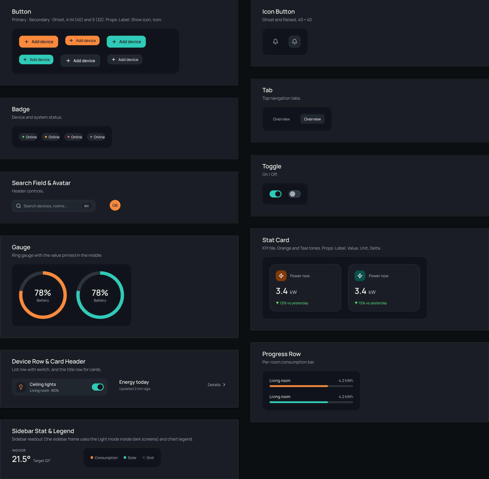

# Summit

A dark-first design system for a smart home dashboard: near-black blue-gray surfaces that lift by getting lighter, orange for data and the main action, teal for live systems and scenes, lake-house photography, and Manrope throughout. It was designed in Figma first, in the file **Summit — Smart Home Design System**, and every value here is exported from that file.

**Working app built with it:** [Summit Home](https://github.com/guiboorges/summit-home) ([live demo](https://guiboorges.github.io/summit-home/)).


## Contents

| Path | What it is |
|---|---|
| `tokens/color.tokens.json` | 35 primitives (neutral, orange, teal, green, amber, red) and 24 semantic roles in `dark` and `light`, aliasing the primitives |
| `tokens/typography.tokens.json` | The 13 text styles (Display, Heading H1–H3, Title, Body, Body Strong, Label, Caption, Overline, Metric XL/L/M) |
| `tokens/layout.tokens.json` | Spacing (4 px base), radii (xs 6 → 2xl 28, full), shadows (card, floating, window, orange and teal glow), glass |
| `css/summit.tokens.css` | **Generated** CSS variables (`--summit-*`). Run `python3 build/build-css.py` after editing tokens. |
| `assets/icons/` | The 29 Lucide icons used in the Figma library (ISC license) |
| `assets/images/` | The two lake-house photos, generated with Figma AI |
| `preview/` | Figma exports of the dashboard (dark and light) and the components page |

## Use it

```html
<link rel="stylesheet" href="https://fonts.googleapis.com/css2?family=Manrope:wght@400;500;600;700&display=swap">
<link rel="stylesheet" href="summit/css/summit.tokens.css">
```

- **Theme:** dark by default, light when the OS prefers it. Force one with `<html data-theme="light">` or `data-theme="dark"`.
- **Pinned modes:** like Figma's explicit variable modes, `class="summit-light"` or `class="summit-dark"` pins a subtree. The sidebar pins light inside dark screens; cards with photos pin dark so their text keeps its contrast in both themes.
- **Roles only:** components use the semantic variables (`--summit-bg-surface`, `--summit-text-secondary`, `--summit-data-orange`…), never the primitives.
- **Accents:** put dark ink (`--summit-text-on-accent`) on orange and teal, never white (white on orange is 2.3:1).
- **Charts:** in light mode the data colors switch to darker steps (`orange/500`, `teal/600`) to keep 3:1 against white.



## The working app

[Summit Home](https://github.com/guiboorges/summit-home) is the Overview screen built with these tokens, running on a simulated lake house ([live demo](https://guiboorges.github.io/summit-home/)).


## Accessibility

All text roles pass WCAG 2.2 AA (4.5:1) against `bg/surface` in both modes; the Figma color page lists every ratio. Two things to know:

| Item | Contrast | Rule |
|---|---|---|
| Orange and teal button fills on white (light mode) | 2.35:1, 2.05:1 | Fine for buttons, because the dark label identifies them (WCAG 1.4.11). Never use the fill alone to mark state or data on white. |
| `data/track`, `border/subtle` | below 3:1 | Decorative only. Control boundaries use `border/control` (≥ 3:1). |
